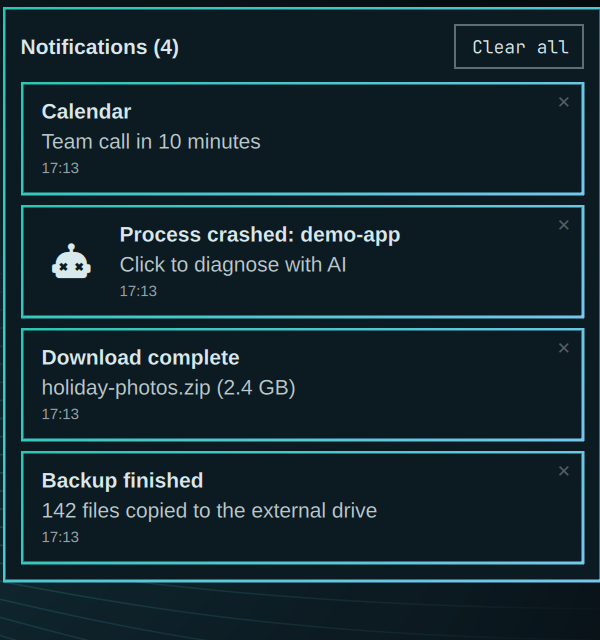
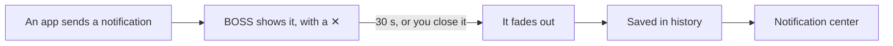

<div align="center">

<h1>BOSS Notification Manager</h1>

<h4>Notifications on Omarchy you can close, that fade away on their own, and that you can look back at.</h4>

<p>


</p>

<a href="#-what-it-does">What it does</a> •
<a href="#-get-started">Get started</a> •
<a href="#-how-it-works">How it works</a> •
<a href="#-faq-and-troubleshooting">FAQ</a> •
<a href="#%EF%B8%8F-for-developers">For developers</a>

<br><br>


</div>

BOSS is short for **BrahmaOS Shell Suite**: small desktop tools for the Linux edition of BrahmaOS. This is the first one.

On Omarchy 4.0.x an urgent notice, such as "Process crashed", stays on screen until you right-click it. Nothing tells you that. BOSS fixes that and adds a notification center. Status: early, tested on Omarchy 4.0.6 only.

## ✨ What it does

- ✖️ **A close button on every notification** – click the ✕ to make it go. Clicking it never starts the notification's action.
- ⏳ **Urgent notices go away by themselves** – they stay 30 seconds, then fade out. Point at one to keep it on screen.
- 🌫️ **A soft fade** – notifications fade out instead of vanishing.
- 🔔 **A notification center** – one key shows your last 50 notifications, newest first, with the time each came in.
- 🧹 **Tidy up in one click** – close single entries with their ✕, or empty the list with **Clear all**.
- 🔁 **Nothing else changes** – do not disturb, keyboard shortcuts and notification history work as before.

<p align="center">

</p>

The screenshots use made-up demo notifications.

## 🚀 Get started

You need Omarchy 4.0.6 and a terminal.

1. **Download.** Run:
   ```bash
   git clone https://github.com/sudharamachandranrajeev/boss-notification-manager
   cd boss-notification-manager
   ```
2. **Install.** Run `./install.sh`. The bar disappears for a second while the desktop shell restarts. Notifications on screen come back.
3. **Try it.** Run:
   ```bash
   omarchy notification send -u critical "Hello" "I fade out after 30 seconds"
   ```
   The notice has a ✕ in its corner. Leave it and it fades after 30 seconds.
4. **Open the notification center.** Press <kbd>Super</kbd> + <kbd>Shift</kbd> + <kbd>Alt</kbd> + <kbd>,</kbd>. Press it again or <kbd>Esc</kbd>, or click anywhere else, to close it.
   - Click an entry to run its action. For a crash notice, that starts the AI diagnosis.
   - Click an entry's ✕ to remove it from the list.

**To remove BOSS**, run `./uninstall.sh` in the same folder. Omarchy's own notifications come back, with your history.

## 🧭 How it works



- Omarchy lets you swap one of its built-in parts for your own copy (`omarchy plugin clone`). BOSS is such a copy of the notifications part, with the changes above.
- Your copy lives in `~/.config/omarchy/plugins/boss.notifications`. Omarchy updates do not overwrite it.
- History is the same set of files Omarchy uses, in `~/.local/state/omarchy/notifications/history`. BOSS keeps 50 instead of 10.

## ❓ FAQ and troubleshooting

<details>
<summary><b>install.sh says my Omarchy version was not tested</b></summary>

BOSS is a copy of the notifications part from Omarchy 4.0.6. A newer Omarchy may have changed that part, and BOSS would hide those changes. Check this page for a newer BOSS first. To install anyway, run `./install.sh --force`.
</details>

<details>
<summary><b>Is this needed once Omarchy updates?</b></summary>

Maybe not. Omarchy has already added a ✕ to notifications for its next big release ("quattro"). It has turned down the changes that would limit how long urgent notices stay, because the notification standard says they should not expire. When that release comes out, remove BOSS if the ✕ is all you wanted.
</details>

<details>
<summary><b>Notifications stopped showing after I installed</b></summary>

Run `omarchy restart shell`. If they still do not show, run `./uninstall.sh` to go back to Omarchy's own notifications, and open an issue on this page.
</details>

<details>
<summary><b>An urgent notice went away before I read it</b></summary>

Open the notification center with <kbd>Super</kbd> + <kbd>Shift</kbd> + <kbd>Alt</kbd> + <kbd>,</kbd>. Everything that left the screen is there.
</details>

## 🛠️ For developers

<details>
<summary>Layout, tests and checks</summary>

- `plugin/` is the plugin. Commit `903edf7` is Omarchy 4.0.6's notifications plugin unchanged, so `git diff 903edf7 -- plugin/` shows every BOSS change.
- `plugin/manifest.json` sets `omarchy.clonedFrom` to `omarchy.notifications`. That makes Omarchy route the built-in's calls, such as `omarchy-shell notifications showHistory`, to BOSS.
- The service is `keepLoaded`, so a plugin reload does not swap it. `install.sh` and `uninstall.sh` restart the shell.
- Extra IPC calls: `omarchy-shell notifications toggleCenter` and `omarchy-shell notifications closeCenter`.
- Tests for the plain logic: `node --test`. Plugin check: `omarchy plugin validate plugin`.

</details>

## License

MIT. The plugin is based on [Omarchy](https://github.com/basecamp/omarchy)'s notifications plugin (MIT, © David Heinemeier Hansson). See [LICENSE](LICENSE).

> GitHub [@sudharamachandranrajeev](https://github.com/sudharamachandranrajeev)
